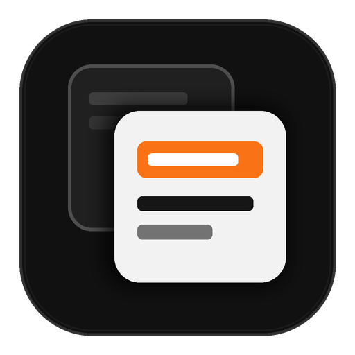
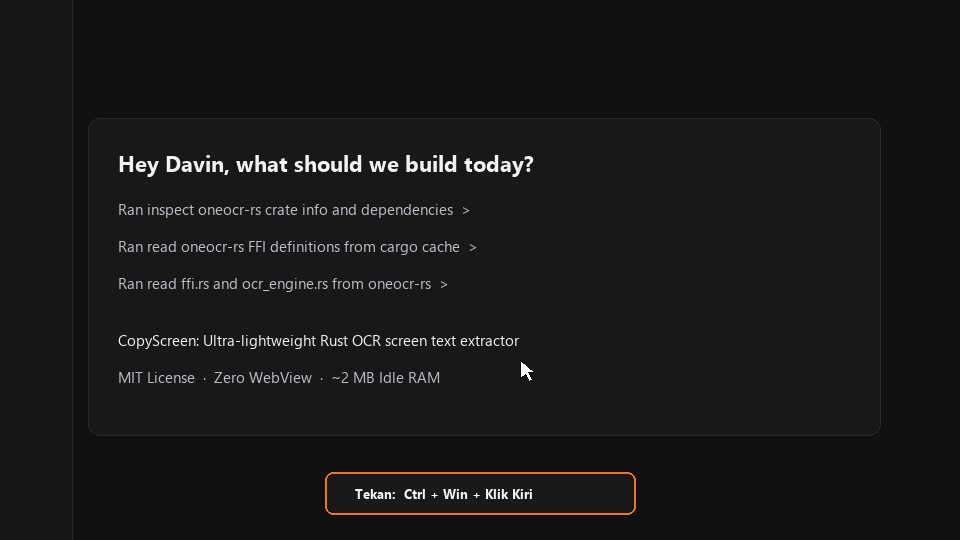

<div align="center">
  
  <h1>CopyScreen</h1>
  <p><strong>Aplikasi Open-Source (MIT) Ekstraktor Teks Layar Ultra-Ringan untuk Windows 10 & 11</strong></p>
  <p>
    <a href="https://github.com/Davinsry/CopyScreen/releases/latest"><strong>Download CopyScreen Portable (.exe)</strong></a>
    ·
    <a href="./LICENSE">MIT License</a>
  </p>
</div>

---

## Demo Penggunaan

<div align="center">
  
  <p><em>Video resolusi penuh tersedia di <a href="./assets/demo.mp4">assets/demo.mp4</a></em></p>
</div>

---

## Tentang CopyScreen

**CopyScreen** adalah utilitas *open-source* (**MIT License**) berbasis **100% Pure Rust + Native Windows API (`Win32`, `Direct2D`, `DirectWrite`, & `Windows.Media.Ocr`)** yang memungkinkan kamu menyalin tulisan apa pun yang tampil di layar (gambar, video, PDF terkunci, UI aplikasi, hingga game) hanya dengan menekan **`Ctrl + Windows + Klik Kiri`**.

Dirancang tanpa Electron, tanpa WebView, dan tanpa bundel model ratusan megabyte sehingga ukuran file `.exe` hanya sekitar **`~410 KB`** dan penggunaan RAM saat aktif di *System Tray* sangat minimal (`~1,5 - 3 MB`).

---

## Fitur Utama

- **Shortcut Instan (`Ctrl + Windows + Klik Kiri`)**
  - Klik di mana saja pada layar sambil menahan `Ctrl + Win` untuk langsung membekukan tampilan monitor dan mendeteksi seluruh teks di layar.
  - Dilengkapi **Mode Stealth (`WS_EX_NOACTIVATE`)** yang menjaga fokus browser tetap aktif (tidak memicu `window.onblur` / deteksi pindah tab) serta menahan klik kiri/kanan di level OS agar aman dipakai di atas halaman web yang sensitif.
- **Animasi Visual 60 FPS (Direct2D Hardware-Accelerated)**
  - **Ocean-Navy Tint & Edge Aura:** Lapisan warna gelap transparan dengan garis tepi layar bercahaya.
  - **Cursor-Following Torch Glow:** Pendaran cahaya ungu, pink, dan biru yang bergerak mulus mengikuti kursor mouse.
  - **Line-Level Text Capsules:** Setiap baris teks yang terdeteksi dibungkus kapsul gelap membulat dengan efek *backlit shimmer* tanpa mengotori ikon aplikasi/dokumen.
- **2 Mode Seleksi Teks ("Seret dari Mana ke Mana")**
  - **Mode Teks Linear (`I-Beam`):** Seret kursor dari kata awal ke kata akhir mengikuti urutan baca baris demi baris (persis seperti memblok teks di browser), atau seret di dalam satu kata panjang untuk mengambil sebagian karakter.
  - **Mode Kotak Area (`Box`):** Tahan `Shift` / `Alt` saat menyeret (atau klik tombol `Kotak Area` di toolbar atas) untuk menyeleksi teks menggunakan kotak persegi pada tabel atau kolom.
- **UI Pengaturan `#111111` & Auto-Start Aktif Otomatis**
  - Klik ikon **CopyScreen** di *System Tray* untuk membuka jendela pengaturan bertema karbon `#111111`: pilih 6 *preset shortcut* (termasuk opsi `Tombol Samping Mouse` tanpa keyboard), rekam *shortcut* kustom, atau atur fitur **Jalankan Otomatis Saat Windows Menyala (Auto-Start)**.

---

## Cara Menggunakan

### 1. Download Langsung (Portable `.exe`)
1. Buka halaman [**Releases**](../../releases) di repositori GitHub ini.
2. Unduh file **`CopyScreen-vX.Y.Z-portable-x64.exe`** (atau jalankan `CopyScreen.exe`).
3. Tekan **`Ctrl + Windows + Klik Kiri`** di mana saja pada layar, lalu seret teks yang ingin disalin. Begitu klik dilepas, teks otomatis masuk ke *Windows Clipboard* (`Ctrl + V`)!

### 2. Kontrol Saat Overlay Aktif
| Aksi | Fungsi |
| :--- | :--- |
| **Seret Klik Kiri (Drag & Release)** | Memilih teks dari titik awal ke titik akhir & otomatis menyalin ke *Clipboard* |
| **Tahan `Shift` / `Alt` + Seret** | Beralih sementara ke **Mode Kotak Area (Box Select)** |
| **Klik Tombol `Salin Semua`** | Menyalin seluruh teks yang terdeteksi di layar sekaligus |
| **`Ctrl + C`** | Menyalin teks yang sedang terpilih |
| **`Esc` / Klik Kanan / Tombol `✕`** | Membatalkan dan menutup *overlay* |

---

## Build dari Source (Rust)

Pastikan kamu menggunakan Windows 10/11 dan sudah memasang [Rust (`rustup`)](https://rustup.rs/).

```powershell
# 1. Clone repositori
git clone https://github.com/Davinsry/CopyScreen.git
cd CopyScreen

# 2. Jalankan seluruh unit & integration test
cargo test

# 3. Build binary release
cargo build --release
```

File hasil kompilasi akan tersedia di `target/release/copyscreen.exe`.

---

## Lisensi

Proyek ini dilisensikan di bawah [**MIT License**](./LICENSE).
